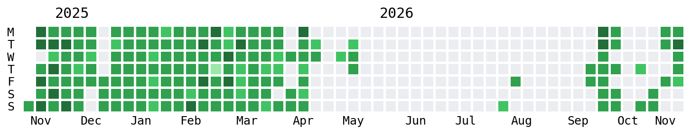

# Concept2 Backup



自动备份 Concept2 Logbook 训练数据（TCX），并发布一个基于 `stats.json` 的可视化页面（GitHub Pages）。

## 功能

- 自动/手动下载 Concept2 训练记录
- 按年份保存 TCX：`data/<year>/YYYY_MM_DD_<result_id>.tcx`
- 增量更新统计数据：`data/stats.json`
- 自动生成热力图：`data/profile-heatmap.png`
- 通过 Cloudflare Worker 接收 Concept2 webhook 并触发 GitHub Actions
- 构建并部署 Web 仪表盘到 GitHub Pages

## 架构

```
Concept2 Webhook
  -> Cloudflare Worker
    -> GitHub repository_dispatch (c2_new_activity)
      -> .github/workflows/backup.yml
        -> scripts/*.py 下载/更新数据
        -> web/ 构建并部署 Pages
```

如果不配置 Webhook，也可以手动触发工作流做全量、单条或指定日期下载；定时任务每天核对前一天的活动。

## 目录结构

```
.
├── data/                       # 训练数据、统计结果、热力图
├── scripts/                    # Python 下载与统计脚本
├── worker/                     # Cloudflare Worker（Webhook 转发）
├── web/                        # React + Vite 前端
└── .github/workflows/          # 自动化工作流
```

## 前置条件

- Python 3.13（配合 `uv`）
- Node.js 22（前端构建与 Worker 工具链）
- Concept2 Access Token（用于 API 调用）

## 一次性配置（GitHub）

在仓库 `Settings -> Secrets and variables -> Actions` 添加：

- `C2_ACCESS_TOKEN`：Concept2 Logbook Access Token

`GITHUB_TOKEN` 由 Actions 自动提供，不需要手工创建。

## 工作流说明

### 1) `backup.yml`（主工作流）

触发方式：

- `repository_dispatch`（由 Worker 触发）
- `workflow_dispatch`（手动触发）
- `schedule`（每天核对前一天的活动，按北京时间计算日期）

手动触发参数：

- `mode=full`：全量下载历史
- `mode=single` + `result_id`：下载单条训练
- `mode=day` + `workout_date`（`YYYY-MM-DD`）：核对指定日期的全部训练，只补缺失项

执行内容：

- 校验 Token
- 下载数据（全量或单条）
- 生成/更新 `data/stats.json` 与 `data/profile-heatmap.png`
- 提交 `data/` 变更
- 构建 `web/` 并部署到 GitHub Pages

### 2) `download-full-history.yml`

仅用于手动全量下载历史并提交数据（不部署前端）。

## 本地开发

### Python 脚本（`scripts/`）

```bash
cd scripts
export C2_ACCESS_TOKEN="<your_token>"

uv sync
uv run simple_auth.py
uv run download_history.py
uv run download_single.py 12345
uv run update_heatmap.py
```

### 前端（`web/`）

```bash
cd web
pnpm install
pnpm dev
pnpm build
```

前端读取 `./stats.json`。本地调试时需要把仓库根目录的 `data/stats.json` 放到 `web/public/stats.json`。

### Worker（`worker/`）

```bash
cd worker
npm ci
npm test
```

生产配置时在 `worker/` 下执行 `npx wrangler login`、`npx wrangler secret put GITHUB_PAT` 和 `npx wrangler secret put WEBHOOK_SECRET`。为 `WEBHOOK_SECRET` 生成至少 32 字节的密码学随机值，并编码为 base64url（32 字节对应 43 个字符）；Worker 只接受 43–128 个 base64url 字符。将它作为 Worker Secret 保存，并把**同一值**填入下方的 Webhook URL。不要把真实值写进仓库、Issue、截图或日志。`GITHUB_PAT` 是 Worker 调用目标仓库 repository dispatch 的令牌：细粒度 PAT 授予该仓库 **Contents: write**，传统 PAT 需要 `repo` scope；无需为这个 API 额外授予 Actions 权限。`C2_ACCESS_TOKEN` 只存于 GitHub Actions Secrets，供下载脚本读取 Concept2 API。Worker 的速率限制绑定见 `worker/wrangler.toml`；部署前应核对其 namespace ID 在 Cloudflare 账户中唯一。

部署 Worker 前请检查 [Worker 专用说明](worker/README.md)，并按生产变更流程执行 `wrangler deploy`。

## Webhook 配置

在 Concept2 开发者页面，为目标 OAuth 应用配置**完整**的 Webhook URL：

```text
https://<your-worker-host>/webhook/<WEBHOOK_SECRET>
```

Worker 只接受这个精确路径上的 POST；只填 Worker 根地址会得到 401。然后确认当前 Logbook 账户已授权**配置该 Webhook URL 的同一个应用**：在 `Edit Profile → Applications → Clients` 查找该应用。必要时使用该应用开发者页面上的 OAuth Link 完成授权。GitHub Actions 中个人 `C2_ACCESS_TOKEN` 有效，仅说明下载 API 可用，不能代替这个应用授权。Concept2 [官方说明](https://log.concept2.com/developers/documentation/#webhooks)只向授权了该应用的用户发送训练事件。

当前 Worker 会处理：

- `result-added`
- `result-updated`
- `result-deleted`

Concept2 官方文档给出 `data` 包络（新增/更新 ID 在 `data.result.id`，删除 ID 在 `data.result_id`），但[历史生产投递](https://github.com/AEliu/concept2-backup/commit/6e85ed23ef956715014f1663a445b928e4361929)曾使用无包络的顶层 `type`、`result` 或 `result_id`。Worker 兼容这两种受限格式，并将等价事件规范化后触发 GitHub 的 `c2_new_activity`，传递 `result_id`、`event_type` 和 `event_digest`。

## 数据产物

- `data/<year>/*.tcx`：原始训练文件
- `data/stats.json`：按天聚合的距离统计
- `data/profile-heatmap.png`：近 365 天热力图

## 常见问题

- GitHub Actions 的 Concept2 API 校验报 401：检查 `C2_ACCESS_TOKEN`；Worker 的 POST 返回 401：检查 Webhook URL 的路径与 Worker `WEBHOOK_SECRET` 是否一致
- 新活动未即时触发：先核对同一 Concept2 应用是否已授权，再查看 Worker 的真实 POST 请求和 GitHub Actions 的 `repository_dispatch` 运行。直接调用 GitHub repository dispatch 仅验证 GitHub 侧；`schedule` 补录成功也不能证明即时 Webhook 正常
- 调试 Worker 时，原始 `wrangler tail` 事件可能含带密钥的完整请求 URL。只记录脱敏后的时间、HTTP 状态、`X-Request-Id` 和错误短语，不发布原始日志
- 前端没有数据：确认 `web/public/stats.json` 已注入最新数据（CI 中会自动复制）

## 相关文档

- Concept2 API: https://log.concept2.com/developers/documentation/
- GitHub repository dispatch: https://docs.github.com/en/rest/repos/repos#create-a-repository-dispatch-event
- Cloudflare Workers: https://developers.cloudflare.com/workers/
